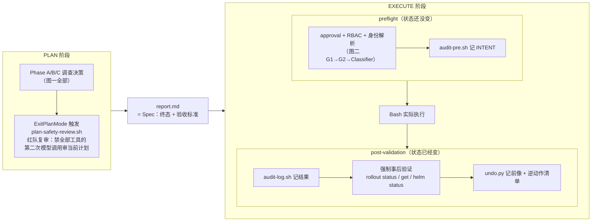
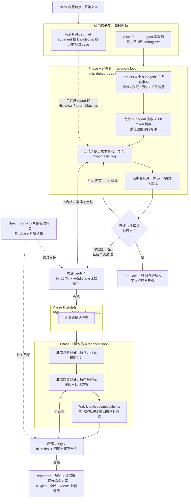
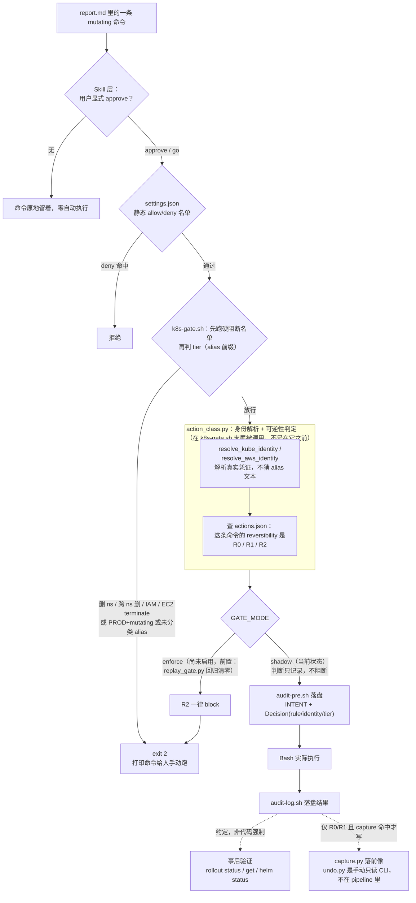

# Architecture

两张图。调查和执行这两条路径的约束方向刚好相反：**调查要松绑（路径随便走，只钉终点），执行要收紧（每一步都要过关）**。这份文件只讲架构，工作流细节见各 skill 文件，护栏细则见 `SKILL.md` §0，可逆性判据见 `rules/axioms/t13_sre_as_nested_control_loop.md`。

---

## 〇、四个控制原语，与 Plan / Execute 两阶段

在细看两张图之前先给坐标系。整套系统由四个控制原语搭起来，每个都能在 K8s 里找到对应；而这四个原语落到时间轴上，又天然分成 Plan 与 Execute 两个阶段，各自有自己的 preflight 与 post-validation。

### 四个控制原语对应哪

| 原语 | K8s 对照 | 在这两张图里是什么 |
|---|---|---|
| **Spec** | 期望状态 manifest | `report.md`（图一的产出）：写明终态判定（verdict、收敛的假设）与机器可检的验收标准（Iron Laws），可 diff、可 review、context 压缩后可从文件恢复 |
| **Loop** | controller 的 reconcile loop | 出现三次：图一 Phase A、图一 Phase C、图二强制事后验证。每次都是"现状 → 比对 Spec → 行动 → 验证"，只是比对的 Spec 和现状不同，见图一下方说明 |
| **Hook** | RBAC（静态、身份维度）+ admission webhook（动态、看内容、fail-closed） | 图二整条链：`settings.json` 名单是 RBAC，`action_class.py` 身份解析 + `k8s-gate.sh` 判定是 admission webhook |
| **Fork** | pod 级隔离 + 独立审计者 | 图一 Fork（fast/slow 双路）+ P1（4 个 subagent fan-out）；下面提到的红队复审是"独立审计者"这个角色的另一个实例 |

### Plan / Execute 两阶段，各自的 preflight 与 post-validation

图一整体是 **Plan** 阶段：不是"想好怎么做"这种口头计划，产出物就是 Spec 本身（`report.md`）。图二整体是 **Execute** 阶段。两阶段各自都有 preflight，且 Plan 阶段的 preflight 比图二里画的更早一步——它审的是**计划本身**，不是某一条具体命令：

三个检查点，两个不同的高度，容易被当成一件事，其实不是：

| 检查点 | 审的是什么 | 什么时候 | 谁做 |
|---|---|---|---|
| Plan-level preflight | 整个调查/决策计划合不合理 | ExitPlanMode，report.md 命令还没逐条生成之前 | 第二次模型调用，工具全禁，只读当前计划文本 |
| Command-level preflight | 这一条具体命令能不能放行 | 每次 approve 之后，真正 Bash 执行之前 | 确定性代码（RBAC 名单 + 身份解析 + tier 判定），不再问模型 |
| Post-validation | 执行完的状态对不对 | Bash 跑完之后 | 确定性代码（`rollout status` 之类）+ 落盘前像供 `undo.py` 使用 |

Plan-level 那道用的是模型（红队复审），因为"这个计划合不合理"需要语义理解；Command-level 和 post-validation 两道都刻意换成了确定性代码——这正是本文件"让 agent 少判断"那条思想在时间轴上的体现：越靠近真正改状态的那一刻，判断权越要从模型手里收回来。

---

## 一、调查（读，只读，松绑）

Phase A 与 Phase C 各自是一个独立的 reconcile loop，不是"状态机 + 结束时才跑一次的 linter"。早期版本把 Phase A/B/C 整体标成"计划"，把 P3→P4→Check 的往复直接叫作 Loop，这个说法不精确：那时候 report.md（Spec）还不存在，没有已声明的目标可比对，严格说是在"搜索"一个目标，不是在"reconcile"一个目标。

修正后的版本给每个 phase 一个明确的比对目标：`verify.py` 的 8 条验收标准按 phase 拆成子集，Phase A 结束前、Phase C 结束前各跑一次局部 verify，不合格就地打回，不许往下走。这样 Phase A/C 才真正符合 Loop 的定义：现状（已收集证据 / 已生成命令）→ 比对 Spec（局部验收子集）→ 行动（修正假设 / 补齐命令）→ 再验证。

### 这半张图的判据

| 环节 | 判据 | 出处 |
|---|---|---|
| Subagent 隔离 | context 是稀缺资源，原始数据不进主 agent，一律回收 ≤500 token 摘要 | `SKILL.md` §0「Subagent Isolation」 |
| Phase Lock | 用物理文件访问边界防"看到就脑补"，不是靠提醒。Phase A 读不到 deploy history，无从锚定 | `skills/sre-oncall-init/phase_lock.md` |
| 竞争假设管理 | 证据的价值在于能否淘汰假设，不在于支持了哪个假设。连续 3 条假设被否强制升级，防查不出结果时死磕 | `skills/sre-oncall-acceptance-criteria/SKILL.md` Iron Law 2 |
| 止血候选打分 | 根因未知时先动手的候选按撤回成本分档：R0 撤回秒级在线，R1 撤回是一次中断，R2 撤回不存在永不出现在候选表 | `knowledge/mitigations/README.md`；判据出处 `rules/axioms/t13_sre_as_nested_control_loop.md` §1 |
| **局部 verify（PVa/PVc，文档层面的设计，尚未接代码）** | 现有实现里 `verify.py` 只在 report.md 全部写完后跑一次，返工发生在最贵的时候。把验收标准按 phase 拆子集、在每个 phase 结束前跑，属于同一原理的自然延伸，但需要改 `phase_lock.md` 的切换条件和 `verify.py` 的调用时机，是另一轮工作 | 本图为设计提案，非当前已实现行为 |

---

## 二、执行（写，任何一条 mutating 命令都要走这条路）

> 图里两处虚线是刻意的：**事后验证和前像捕获都没有代码强制**。事后验证目前只是 `k8s-gate.sh` 在执行前打印的一行 stderr 提示加 `CLAUDE.md` 里的约定，没有任何 PostToolUse hook 检查结果或拦截；`state/undo/` 至今 0 个文件，因为真实流量 89% 是 `kubectl exec`（R2），而 R2 按设计不抓前像。把它们和 G2/G4 那种真 gate 画成同一种实线框会造成误解。

### 这半张图的判据

| 环节 | 判据 | 出处 |
|---|---|---|
| 身份解析而非文本猜测 | policy 是 `f(真实身份, 可逆性)`，不是 `f(命令里那个词像不像 prod)`。cluster alias 是转述，`kubectl config current-context` / `aws sts get-caller-identity` 才是一手事实 | `tools/agent_ops/DESIGN_write_path.md` §1、§4；`tools/agent_ops/action_class.py` |
| Reversibility 三档 | **R0**（撤回秒级在线）/ **R1**（撤回是一次中断）/ **R2**（撤回不存在，一律 block）。tier 只能收紧不能放宽。注：`DESIGN_write_path.md` §4 里写的 `auto/manual/none` 是对齐 MCP SEP-2793 草案的**早期提案措辞**，实现最终走的是 R0/R1/R2，与 `knowledge/mitigations/` 和 axiom T13 共用同一套词表，代码和审计日志里只存在后者 | `tools/agent_ops/actions.json`（20 条规则全部 R0/R1/R2）；`action_class.py`；审计日志 `logs/2026-09-21.jsonl` |
| Shadow 模式 | 新分类层先旁观记录，不实际拦人。翻 enforce 前必须先跑六个月历史命令重放，把每一处"旧放行→新阻断"解释清楚，"旧阻断→新放行"必须为零 | `tools/agent_ops/hooks/k8s-gate.sh`；`tools/agent_ops/test/replay_gate.py` |
| 事后验证（**约定，非代码强制**） | 约定是"验证失败或含糊就停下报告"，但实现上只有 `k8s-gate.sh` 执行前打印的一行 stderr 提示；PostToolUse 只挂了 `audit-log.sh`，它只记录 stdout/stderr，不检查结果也不拦截。这条目前靠自觉 | 项目根 `CLAUDE.md` §K8s/AWS Operations；`hooks/k8s-gate.sh`（提示行）；`hooks-manifest.json`（PostToolUse 实际只有 audit-log / mcp-audit） |
| 安全机制自查 | 测试套件做到"物理上不可能造成伤害"而不是"概率上不会造成伤害"：`decide()` 纯函数不执行命令、测试 PATH 指向够不到真实集群的 stub | `tools/agent_ops/test/README.md`（S1-S4 四层隔离） |

### 一次真实回放（2026-09-21）

21009 条去重后的历史命令，legacy 复刻件校验 250/250 一致：

| 转变 | 数量 | 含义 |
|---|---|---|
| 旧放行 → 新放行 | 8935 | 不变 |
| 旧阻断 → 新阻断 | 499 | 不变 |
| 旧放行 → 新阻断 | 11446 | 新分类层挑出的漏洞，含已确认的 `rds delete-db-instance` 与 prod `kubectl set image` 无声通过两个真实缺口。注：此次回放身份解析离线不可用，一律按 prod 处理，实际接上真实身份后会小很多 |
| **旧阻断 → 新放行** | **134（去重后 13 种模式）** | **回归，必须为零才能翻 enforce。** 13 种全部是 `kubectl exec` 走裸 `--kubeconfig=` 路径而非集群 alias，绕过了新分类层的识别，是一个具体可修的 bug，不是设计缺陷 |

结论：当前仍是 shadow 模式，未启用。翻 enforce 前置：先修裸 kubeconfig 路径识别的 bug，把回归清零。

---

## 依赖哪些 agent 设计机制

| 机制 | 在图里是哪一步 | 解决什么问题 |
|---|---|---|
| 快慢双 fork | 图一入口 | 历史匹配不阻塞正式调查，两条独立跑 |
| Subagent 隔离 + token 预算 | 图一 P1→P2 | context 是稀缺资源，原始数据永远不进主 agent |
| Phase Lock（文件访问边界当状态机） | 图一 PA→PB→PC | 用物理隔离防"看到就脑补"，不是靠提醒 |
| 竞争假设管理 + 强制升级 | 图一 P3→P4→Check | 防过早收敛，也防查不出结果时死磕 |
| 可逆性分档（R0/R1/R2） | 图一 C3、图二 Classifier | 同一份判据横跨"止血候选推荐"和"生产命令放行"，没有两套逻辑 |
| propose-not-execute 边界 | 图一到图二的接缝 | 判断交模型，动作交代码，这条线在 report.md 落地那一刻画死 |
| 身份解析而非文本猜测 | 图二 Classifier | policy 是 `f(真实身份, 可逆性)`，不是 `f(命令里那个词像不像 prod)` |
| Shadow 模式 + 历史回放 | 图二 Mode | 收紧一条安全规则前，先证明它不会误伤，而不是上线后才发现 |

## 依赖哪些思想

| 思想 | 图里体现在哪 |
|---|---|
| 可逆性是自主权的刻度 | 整张图二的骨架就是这条思想的直接实现：R0/R1/R2 不是标签，是决定放行还是拦截的变量 |
| 让 agent 少判断，不是让 agent 看得懂 | 图一 P2 的 500 token 摘要契约、图二 Classifier 用代码解析身份而不是让模型猜——能算出来的都不问模型 |
| 证据的价值在于区分度 | 图一 P4"逐条查证据标支持/否定"，选的是"能淘汰假设的查询"，不是"能佐证当前猜测的查询" |
| 转述不是真相 | 图二 R1 的存在本身：cluster alias 是转述，`kubectl config current-context` 才是一手事实。同一条原则在 `workflow_node_scaleup_failure_triage.md` 里被独立发现过一次 |
| 不发明新控制理论 | 图一 Phase A/B/C 状态机搬的是权限分级思路，图二整套是 K8s admission webhook + RBAC 的直接映射 |
| 安全机制要接受同等怀疑 | 图二 Mode 那个分支——新规则自己也要先被六个月真实数据验证过，才配拥有阻断权 |

## 这一整套怎么体现 harness / context engineering

两张图合起来讲的是同一件事的两半。**Harness 设计**是把上面六条思想从"我知道该这么做"变成"代码逼着它这么做"：Phase Lock 不是文档里写"请先看症状再看变更"，是物理上读不到那个文件；Mutation Gate 不是提示"请谨慎"，是一段与 AI 无关的 shell 脚本用退出码说话。**Context engineering** 是图一那半的具体手艺：**分层加载（MAP→index→chunk，一次 ≤5）、token 预算（subagent 500 字契约）、相位锁（该阶段只给该阶段的信息）**——三件事的共同目的是让主 agent 在需要下判断的那一刻，context 里装的是它现在真正需要的东西，不多不少。

两张图能拼在一起，恰好证明这套方法论是一致的：调查那一半靠 context engineering 保证判断力，执行那一半靠 harness 保证不可逆的错误进不来。
