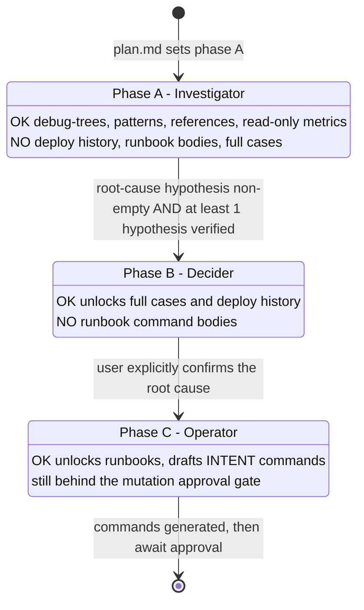
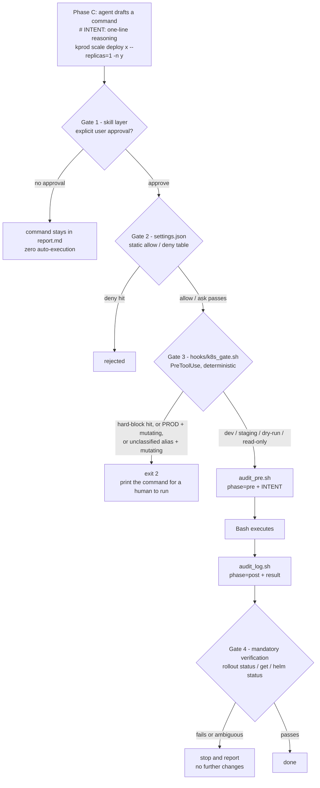

# Method: how this harness thinks

This is the model behind the oncall triage skill, and the order of work the agent follows. Each rule below names the file or mechanism that carries it, and says whether it is **enforced** (code returns an exit code) or **advised** (a prompt asks nicely). The distinction is the point: only enforced rules count as safety.

## First-principles constraint

**Context is scarce RAM, not an infinite disk.** One raw range query can return 30K tokens; a slice of logs is worse. If the main agent pulls that data itself, its context is full of numbers by the time the hard decisions arrive, and its judgment is spent.

So the main agent keeps only three things: navigation, judgment, and command generation. All raw-data fetching is pushed down to a subagent that returns a structured summary of **at most 500 tokens**: the max value with its timestamp, a step-jump flag, and a ratio against baseline. Everything else in this document follows from that one constraint.

## Four control primitives

Not roles (PM agent, QA agent). Controls.

| Primitive | What it is | Where it lives in this harness | Enforced or advised |
|---|---|---|---|
| **Spec** | A persistent file that states the desired end-state with machine-checkable acceptance criteria. Diffable, reviewable, survives context compaction. | `SKILL.md` (entry and routing), `skills/sre-oncall-acceptance-criteria`, `skills/sre-oncall-output-format`, the per-investigation `plan.md` | Advised, then checked by `tools/verify.py` |
| **Loop** | Observe, compare to Spec, act, verify. The tighter the criteria, the more autonomous the loop. | `skills/workflow-oncall-spike` (two-phase triage), fast/slow phases, Gate 4 post-verification | Gate 4 advised in the skill; `verify.py` exit code is enforced |
| **Hook** | Admission control at key nodes: audit records evidence, deny hard-blocks, a human gate waits. | `hooks/k8s_gate.sh`, `hooks/audit_pre.sh`, `hooks/audit_log.sh`, `config/env_map.yaml` | **Enforced** (`exit 2`) |
| **Fork** | Context isolation. Fork for isolation, never for role-play; fork only when isolation gain exceeds briefing plus merge cost. | The 500-token subagent contract in `skills/sre-oncall-query-safety` and `SKILL.md` | Advised (prompt contract) |

This is a Kubernetes control plane moved inside the agent: Spec is the desired-state manifest, Loop is the reconcile loop, Hook is the admission webhook, Fork is pod-level isolation.

## Phase lock

A `phase:` field at the top of `plan.md` restricts what the main agent may read. In phase A it cannot read deploy history, so it cannot confabulate "the last deploy broke it" before the symptom is understood. The gate between phases is a precondition, not a suggestion.

Phase transitions are logged in `plan.md` with a timestamp and a reason. An emergency bypass exists, but the retro must explain why it was used.

## Four gates

A single mutating command must clear four gates; any one stops it.

| Gate | Layer | What it checks | Why it exists | Enforced? |
|---|---|---|---|---|
| 1 | Skill | Explicit user approval; without it the command stays in `report.md` | The human owns every irreversible action | Advised |
| 2 | `settings.json` | Static allow and deny tables | Fastest, coarsest filter | Enforced by the host |
| 3 | `hooks/k8s_gate.sh` (policy in `config/env_map.yaml`, tests in `tests/test_gate.py`) | Alias to environment tier, hard-block table, mutating-verb detection, `# INTENT:` reminder. **An alias not in the map is treated as production (fail-closed).** PROD + mutating exits 2 and prints the command. | The layer the model cannot route around. Hallucination stops being a safety risk. | **Enforced** |
| 4 | Skill + `hooks/audit_log.sh` | After a mutation: `rollout status` + `get`, or `helm status`. Failed or ambiguous verification stops all further changes. | A command that ran is not a command that worked | Advised; `audit_log.sh` records the reminder |

Gate 3 policy by tier:

| Tier | Read | Mutating | Delete | Dry-run |
|---|---|---|---|---|
| prod (and unknown) | pass | **exit 2** + print command | **exit 2** | pass |
| staging | pass | pass with warning, INTENT required, verify hint | **exit 2** | pass |
| dev | pass | pass, INTENT required | warn | pass |
| any tier | hard-block table: delete namespace, delete persistent volume, `--all` / all-namespaces deletes, IAM mutations, instance terminate, explicit `--context prod` | | | |

Known limit: a verb deny-list is fail-open for verbs it has never seen. Gate 3 therefore lists a wide verb set (including `set`, `replace`, `edit`, `annotate`, `label`, `rollout undo`), and Gate 2 plus the audit log are the second line. Compound commands (`&&`, `;`, `|`, newlines) are split and the strictest segment wins; `bash -c "..."` and `eval` are unwrapped (up to three levels); an unparseable command that names an infra tool is treated as a prod mutation. Anything fancier (aliases defined in a shell function, a script file that calls kubectl) is not seen by Gate 3; that is what Gate 2 and the audit trail are for.

## Knowledge compounding

The compounding is a **delta judgment**, not "save the report". Against the existing knowledge files, what did this investigation learn that is new?

| Finding | Action |
|---|---|
| Matches an existing case or pattern | Update that file. Do not create a duplicate. |
| New root-cause path | Create a new case. |
| New signal | Update the routing table. |

Three anti-rot rules: record only the delta; AI-written knowledge stays `draft` until a human promotes it to `stable`; every entry carries `derived_from` pointing back to the triage report.

Every real oncall is also an eval run. `tools/verify.py` gates one investigation by exit code (required sections, evidence chain per conclusion, no over-assertion in the Slack reply). Trends across investigations show whether the skill itself is decaying.

## Method as steps

| Step | Input | Action | Criterion | Artifact |
|---|---|---|---|---|
| T0 Intake | Alert text or link | Extract signals: time, cluster, namespace or service. Missing field: stop and ask. | No guessed values | `Extracted Signals` section |
| T1 Plan | Signals | Write `plan.md` with `phase: A`, a hypothesis list, acceptance criteria | Criteria are machine-checkable | `plan.md` |
| T2 Fan-out | Plan | Dispatch raw queries to subagents (Fork) | Each summary is at most 500 tokens | Subagent summaries in the log |
| T3 Hypothesize | Summaries | Record hypotheses and verdicts (verified, refuted, unknown) | Every verdict cites an evidence id | `Investigation Log` |
| T4 Unlock B | Hypothesis log | Phase A to B only if a hypothesis is non-empty and at least one is verified | Precondition holds | `phase_transitions` entry |
| T5 Decide | Cases, deploy history | Compare with precedent; ask the user to confirm the root cause | Explicit user confirmation | Conclusions with `[E<n>]` references |
| T6 Operate | Confirmed cause | Phase C: draft commands, each preceded by `# INTENT:` | Gate 1 to 3 apply; nothing auto-runs | `Operation Commands` section |
| T7 Verify | Executed change | Gate 4 verification commands | Pass, or stop and report | Audit `phase=post` record |
| T8 Check and compound | `report.md` | `python3 tools/verify.py report.md`; then delta judgment into knowledge | Exit 0 (1 means review warnings; 2 blocks sending) | Updated knowledge file, `derived_from` set |

## Failure modes this harness defends against

| Failure mode | What goes wrong | Defence | Enforced? |
|---|---|---|---|
| Context exhaustion | Main agent pulls raw series, arrives at the decision phase out of tokens | Fork with a 500-token summary contract | Advised |
| Anchoring on the last deploy | Sees a deploy record, invents a root cause before understanding the symptom | Phase lock A (no deploy history) | Advised (path rules in the skill) |
| Hallucinated certainty | "Root cause is definitely X" with no evidence | Evidence chain per conclusion; over-assertion words rejected in `verify.py` | **Enforced** by exit code |
| Unauthorised mutation | Agent runs `scale` or `delete` on production | Gate 3 PROD exit 2, hard-block table | **Enforced** |
| Alias confusion | A new or mistyped cluster alias slips past a tier list | Unknown alias is treated as PROD | **Enforced** |
| Verb the deny-list never saw | `set image` or `replace` passes as "not mutating" | Wide verb set, audit log, Gate 2 | Partly enforced |
| Unreasoned change | Command with no stated reason, unreviewable later | `# INTENT:` reminder, `reasoning: null` recorded in audit | Reminder plus audit |
| Silent failure after change | Change ran, nothing verified | Gate 4; failure or ambiguity stops everything | Advised, audited |
| Knowledge rot | Duplicates, unreviewed AI notes treated as fact | Delta judgment, draft vs stable, `derived_from` | Advised |
| Skill decay | Reports slowly get worse | `verify.py` as eval, pass-rate trend | **Enforced** per report |
| Leaking internal identifiers | Cluster aliases, domains, customers land in a public repo | `.leak_patterns.local` + `tools/check_rules.py` | **Enforced** pre-commit |

## What is and is not published

Published: structure, method, gates, config, tests, and the sanitized knowledge layout. Not published: real incident write-ups, runbook bodies, audit logs and investigation records. See `docs/REQUIREMENTS.md` for the data boundary.
